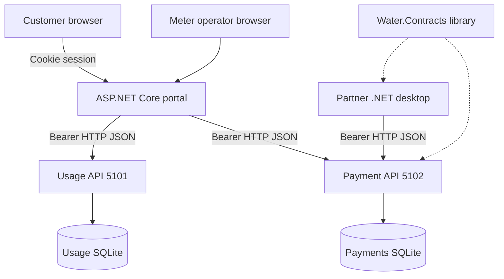
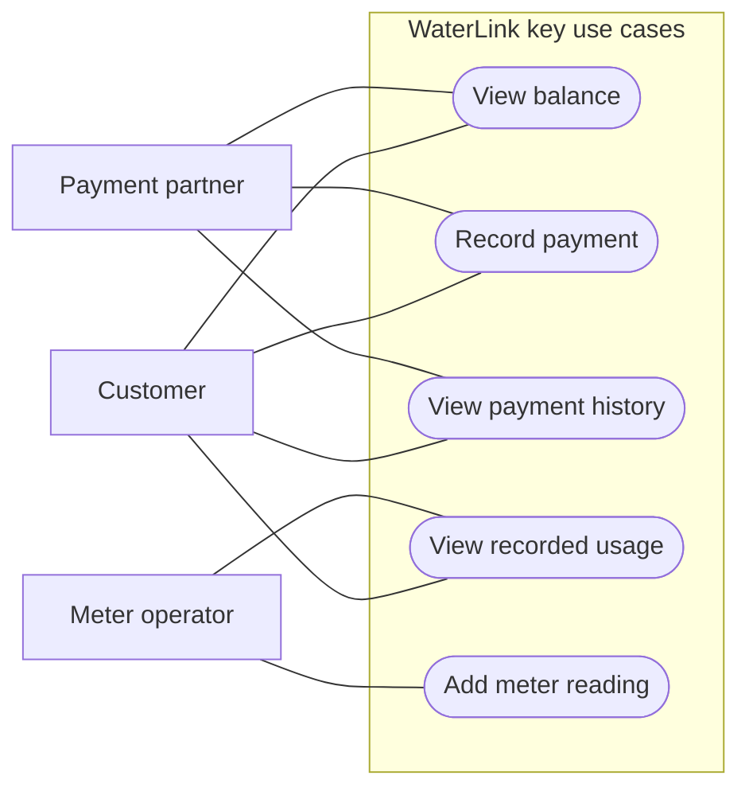
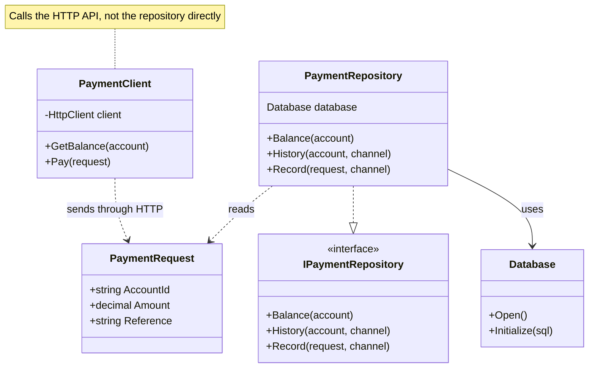
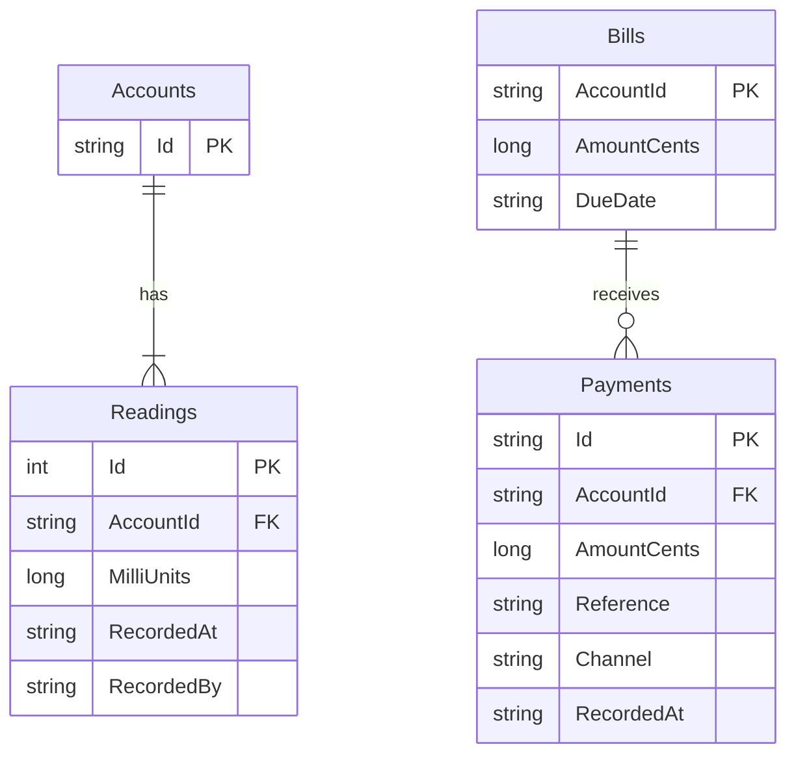

# WaterLink diagrams
All diagrams below are editable Mermaid source. The use case view uses Mermaid flowchart notation to show actors and actions. The two databases are separate; no cross-service foreign key is implied.

## Architecture



## Use cases



## Classes



## Payment sequence

```mermaid
sequenceDiagram
    actor C as Web or desktop client
    participant A as Payment API
    participant R as PaymentRepository
    participant D as Payment database
    C->>A: POST payment with account, amount and reference
    A->>A: Authenticate and authorize caller
    A->>R: Record(request, channel)
    R->>R: Validate money and reference
    R->>D: BEGIN IMMEDIATE transaction
    R->>D: Find channel and reference
    D-->>R: Existing receipt or no match
    alt Matching account and amount
        R-->>A: Existing receipt, replay true
        A-->>C: 200 original receipt
    else Existing reference with changed payload
        R-->>A: Conflict; transaction disposed
        A-->>C: 409 conflict
    else New reference
        R->>D: Read remaining balance
        D-->>R: Available cents
        alt Amount exceeds balance
            R-->>A: Conflict; transaction rolled back
            A-->>C: 409 conflict
        else Valid payment
            R->>D: Insert receipt and COMMIT
            D-->>R: Saved
            R-->>A: New receipt, replay false
            A-->>C: 201 created
        end
    end
    C->>A: GET current balance
    A->>R: Balance(account)
    R->>D: Read billed cents minus paid cents
    D-->>R: Balance
    R-->>A: Balance record
    A-->>C: Current outstanding amount
```

## Data model


