# WaterLink assignment report

[Download the formatted Word report](../output/WaterLink%20CSE5013%20WRIT1.docx) · [Complete diagrams](DIAGRAMS.md) · [Source and setup](../README.md)

This GitHub version follows the Word report. Diagrams are rendered with Mermaid; code excerpts come from the delivered source.

## 1 Architecture choice

### 1.1 Monolithic and service oriented options

NWSDB needs its website and payment partners to show the same balance and payment details. WaterLink provides two .NET services for this purpose. A web portal and a desktop client use these services. The design keeps payment rules in one place so that a new partner does not need to write those rules again.

A monolithic version would put account screens, meter readings, payment rules and partner endpoints in one application. The code could still be split into clear modules. One database would make related updates easier to save together. A small team would have fewer programs to deploy and monitor, so this option could cost less to run at first.

The drawback is that a change to meter processing would normally release the same program that accepts payments. A failure or a busy operation could affect other parts. More copies of the whole program could handle extra requests, but this would also copy parts that do not need extra capacity. A monolith can scale; it simply has a larger unit to scale.

SOA makes business functions available through clear service interfaces. IBM (n.d.) explains that these interfaces support reuse and communication between different systems. In WaterLink, the payment service serves both clients, while the usage service manages readings. Each service owns its data. A client uses HTTP and JSON and does not need to know how the database works.

Table 1 Architecture comparison

| Area | Monolithic application | Service oriented design |
| --- | --- | --- |
| Release | One program is released | Hosts can be released separately |
| Growth | Copy the whole program | Scale the busy service |
| Data | Related changes are easier to save together | Keep each transaction in one service |
| Operations | Fewer hosts to run | More network and failure handling |

The choice also depends on the team. Separate services only help when each has a clear purpose and owner. Splitting every small function into a new service would add calls and support work without a clear gain. Two business services give this prototype enough separation while keeping the local setup easy to understand.

### 1.2 Maintenance growth and choice

For maintenance, a change has a clear home. A meter rule belongs in the usage service. A duplicate-payment rule belongs in the payment service. A screen layout belongs in the client. Separate hosts can be released on their own, provided their public contracts remain compatible. A breaking change still needs a new version and a plan for existing partners.

For growth, payment and usage hosts can be scaled separately. Microsoft (n.d.a) describes the benefits and added work of independent services. The current SQLite setup is suitable for a local demonstration. It must move to a suitable server database before running many API copies on different machines. Adding containers alone would not make separate copies of a payment ledger correct.

The trade-off is more network calls, access checks and failure handling. The portal may be working while a service is down. Updates across separate databases are also harder to manage. WaterLink keeps bills and receipts in one payment service, so recording a payment needs only one database transaction. This is why SOA is the better fit for NWSDB's partner access and long-term maintenance, despite its higher setup effort.

For example, a new payment partner should only need the payment contract and access details. It should not need a copy of NWSDB's meter code. If the receipt layout changes, the payment rules can remain the same. If a payment service release changes a field name, however, both clients may be affected. A stable contract and tests are therefore as important as separate hosts.

For NWSDB, this means that an increase in payment traffic need not force a larger meter service. It also means a meter service outage should not stop a partner from recording a payment. This depends on keeping the payment path free from calls to the usage service. The architecture follows that rule: the payment service owns the bill and receipt data needed to decide whether it can accept a collection.

Before a partner joins, its developer should check the API examples and try both success and error cases. Clear messages help them handle a retry correctly. Keeping these examples with the source makes it easier to update the guide whenever the public contract changes.

## 2 Application design and development

### 2.1 Architecture and scope

WaterLink supports balance lookup, payment recording, receipt history, recorded usage and new meter readings. The two customer accounts and bills are demonstration data. No money moves to a bank. Customer registration, real settlement, email receipts and official tariff calculation are future work.

Figure 1 shows the running parts. Water.Portal hosts the website and forwards service requests. Water.Usage and Water.Payments run separately and own separate SQLite files. Water.Desktop is a .NET payment client. Both clients use the same payment rules through HTTP. REST and JSON keep the web client simple and allow other platforms to connect (Microsoft, n.d.b).

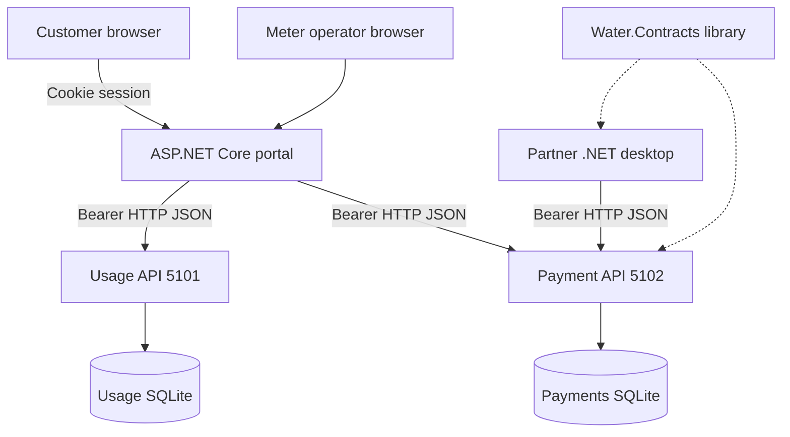

Figure 1 Architecture diagram of the running system

The browser talks to the portal rather than storing service tokens in page code. The portal keeps the selected demo identity in a protected login cookie and supplies the correct token when calling a service. The desktop client is a separate partner consumer. These are two different ways to use the same payment API, which shows why the service contract is useful across application boundaries.

### 2.2 Use cases and access rules

Figure 2 shows the main actions for each user. Customers view their own balance, usage and receipts, and make a demonstration payment. Partners look up a balance and record a collection. Their history contains only their own receipts. The operator is the limited administrator role for adding meter readings.

The API checks the caller's identity and access before acting. Hiding a button is not the security control. A customer who requests another account receives an error. Partners cannot read private usage details, and operators cannot record payments. These rules apply even if someone calls the API outside the website.

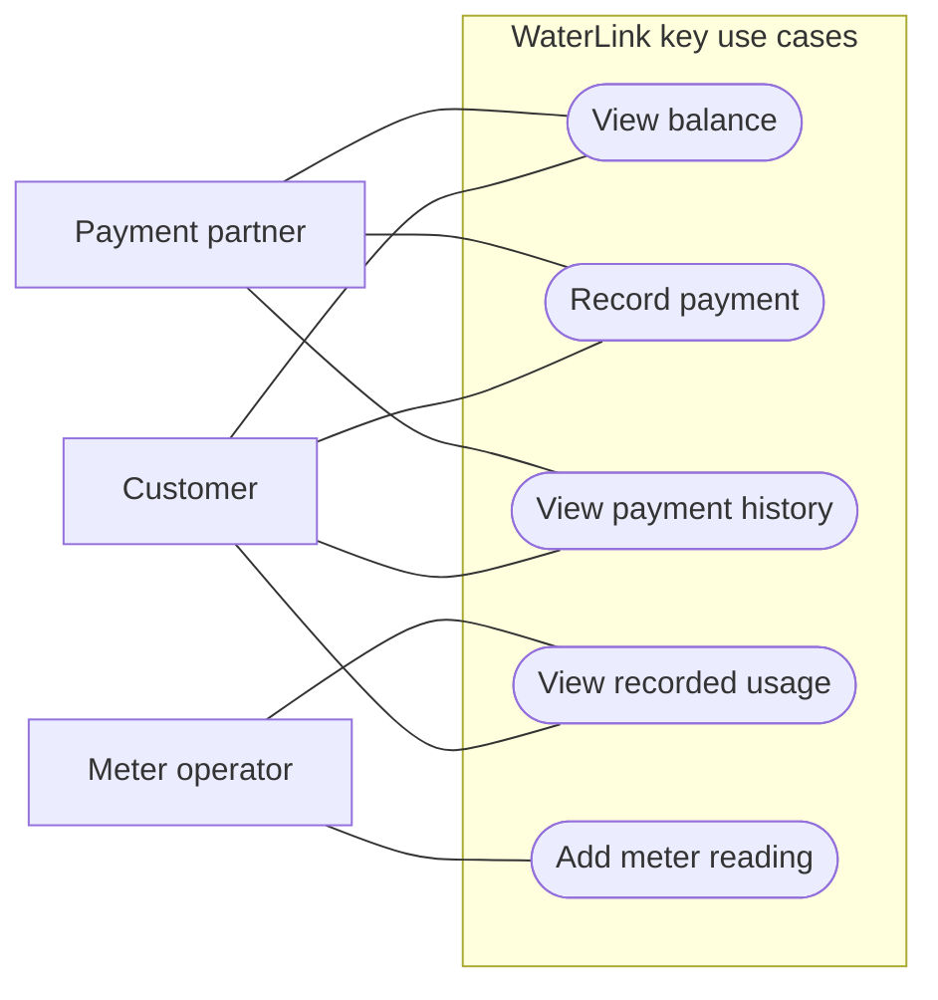

Figure 2 Use case diagram of the main user actions

Each use case has a clear result. A successful payment gives a receipt; a rejected payment gives a reason. A saved reading appears in the account history with its time. A partner can select an account, but cannot use that selection to gain customer access. This keeps the different responsibilities visible in both the interface and service checks.

### 2.3 Classes and code structure

Figure 3 shows selected classes from the actual source. PaymentClient sends HTTP requests. PaymentRequest holds the account, amount and reference. IPaymentRepository defines the work the payment API needs. PaymentRepository carries out that work, while Database opens connections.

Water.Contracts contains the public payment records. Water.Shared contains common checks and database helpers. The API receives its repository through dependency injection, which means the host supplies the object it needs. This keeps request handling separate from SQL code. It also makes future changes easier to test without copying business rules into each client.

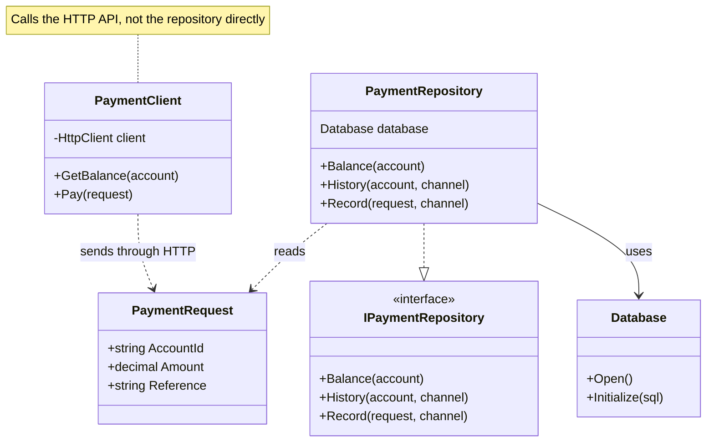

Figure 3 Class diagram of the payment service and client

### 2.4 Payment sequence and data rules

Figure 4 follows a payment from the client to the database. The service checks access, then validates the request. It starts a transaction before checking the reference and balance. A matching repeat returns the first receipt. The same reference with a different amount or account returns a conflict.

```mermaid
sequenceDiagram
    actor C as Web or desktop client
    participant A as Payment API
    participant R as PaymentRepository
    participant D as Payment database
    C->>A: POST payment with account, amount and reference
    A->>A: Authenticate and authorize caller
    A->>R: Record(request, channel)
    R->>R: Validate money and reference
    R->>D: BEGIN IMMEDIATE transaction
    R->>D: Find channel and reference
    D-->>R: Existing receipt or no match
    alt Matching account and amount
        R-->>A: Existing receipt, replay true
        A-->>C: 200 original receipt
    else Existing reference with changed payload
        R-->>A: Conflict; transaction disposed
        A-->>C: 409 conflict
    else New reference
        R->>D: Read remaining balance
        D-->>R: Available cents
        alt Amount exceeds balance
            R-->>A: Conflict; transaction rolled back
            A-->>C: 409 conflict
        else Valid payment
            R->>D: Insert receipt and COMMIT
            D-->>R: Saved
            R-->>A: New receipt, replay false
            A-->>C: 201 created
        end
    end
    C->>A: GET current balance
    A->>R: Balance(account)
    R->>D: Read billed cents minus paid cents
    D-->>R: Balance
    R-->>A: Balance record
    A-->>C: Current outstanding amount
```

Figure 4 Sequence diagram for a new or repeated payment

A new payment is saved only if it does not exceed the balance. Bills and payments are stored as integer cents. The balance is calculated from billed cents minus paid cents, so a second stored balance cannot drift from the receipts. SQLite allows one writer at a time; the transaction uses this rule to protect competing payments (Microsoft, n.d.c).

A new receipt returns HTTP 201. A safe repeat returns 200. Invalid input returns 400, missing identity 401, denied access 403, missing accounts 404 and payment conflicts 409. This retry design follows Microsoft's guidance on idempotency, which means that repeating a request does not repeat its effect (Microsoft, n.d.d).

### 2.5 Service code and client calls

The next four screenshots show exact lines from the delivered source, with file names and line numbers. Long lines wrap only in the view; the source is unchanged. Figure 5 checks money values before converting them to cents. It rejects zero, negative values and fractions of a cent.

Source: [src/Water.Shared/Domain.cs lines 12–18](../src/Water.Shared/Domain.cs#L12-L18)

```csharp
    public static long Cents(decimal amount)
    {
        if (amount <= 0 || amount > 1_000_000 || decimal.Round(amount, 2) != amount)
            throw new DomainException(400, "Enter an amount between LKR 0.01 and 1,000,000 with at most two decimal places.");
        return checked((long)(amount * 100));
    }

```

Figure 5 Code screenshot showing amount validation

The request body carries accountId, amount and reference. The API guide states the allowed values and errors, and the OpenAPI file describes the JSON fields. A partner can use these files to build a client without opening the service project. Settings such as service addresses and database paths are kept outside the payment rules.

The source layout also supports small changes. A new validation rule can be added to the shared checks and tested before either client is changed. A new screen can call the existing endpoint. When a public field must change, a versioned endpoint can let older clients continue working while their owners update them. This avoids forcing all partners to release on the same day.

Figure 6 handles a repeated reference. When the account and amount match, the method returns the existing receipt. When they differ, it rejects the request. A database rule also makes the pair of channel and reference unique. Both checks matter because users or partners may retry after a slow response.

Source: [src/Water.Payments/PaymentRepository.cs lines 49–55](../src/Water.Payments/PaymentRepository.cs#L49-L55)

```csharp
            if (reader.Read())
            {
                var existing = Read(reader);
                if (existing.AccountId != request.AccountId || existing.Amount != request.Amount)
                    throw new DomainException(409, "This reference was already used for a different payment.");
                return (existing, true);
            }
```

Figure 6 Code screenshot showing receipt reuse

Figure 7 connects the HTTP endpoint to the repository. Access is checked before a payment is recorded. Figure 8 shows the desktop client's GET and POST calls. The client uses the public contract, not the service database. This is the key reuse point: different screens reach the same service rules.

Source: [src/Water.Payments/Program.cs lines 23–28](../src/Water.Payments/Program.cs#L23-L28)

```csharp
app.MapPost("/api/v1/payments", (PaymentRequest request, HttpContext context, IPaymentRepository store) => {
    if (context.User.IsInRole("operator")) throw new DomainException(403, "Operators cannot record payments.");
    ServiceSecurity.Allow(context.User, request.AccountId);
    var result = store.Record(request, context.User.Identity!.Name!);
    return Results.Json(new { receipt = result.Receipt, replay = result.Replay }, statusCode: result.Replay ? 200 : 201);
});
```

Figure 7 Code screenshot showing the payment endpoint

Source: [src/Water.Desktop/PaymentClient.cs lines 14–15](../src/Water.Desktop/PaymentClient.cs#L14-L15)

```csharp
    public async Task<Balance> GetBalance(string account) => await Read<Balance>(await client.GetAsync($"/api/v1/accounts/{Uri.EscapeDataString(account)}/balance"));
    public async Task<PaymentResult> Pay(PaymentRequest request) => await Read<PaymentResult>(await client.PostAsJsonAsync("/api/v1/payments", request));
```

Figure 8 Code screenshot showing desktop API calls

### 2.6 Customer screens and payment output

Figures 9 to 12 show the real web payment flow. The customer signs in, enters an amount and reference, and receives a receipt. The screen then asks the service for the new balance. The demonstration shown here records LKR 12.50. No card details are collected.

The form keeps its reference after a failed request so the user can retry safely. After success, it prepares a new reference. Buttons are disabled while a request is running. Labels explain each field, and a status message announces the result. The page also works at small screen widths.

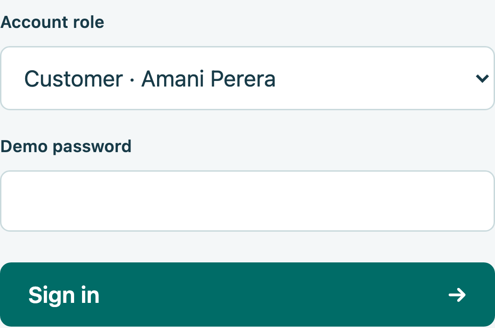

Figure 9 Customer sign in screen

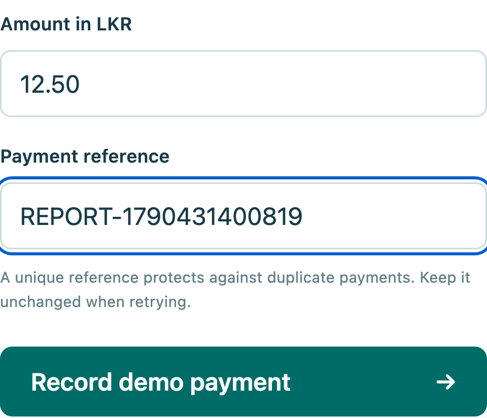

Figure 10 Customer payment form

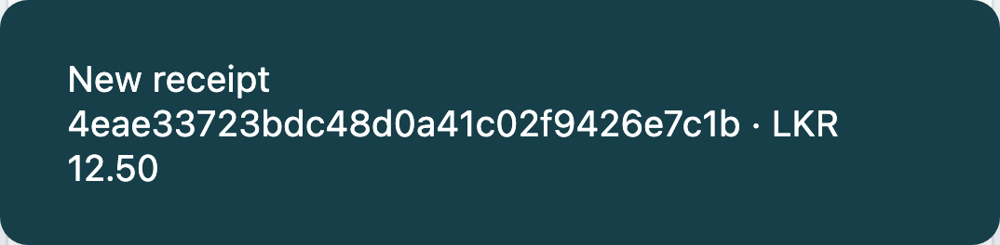

Figure 11 Receipt returned by the payment service

This output was captured from the running local website. The receipt identifies the accepted payment. The next screen shows the balance after the service accepted the payment, rather than a value calculated only in the browser.

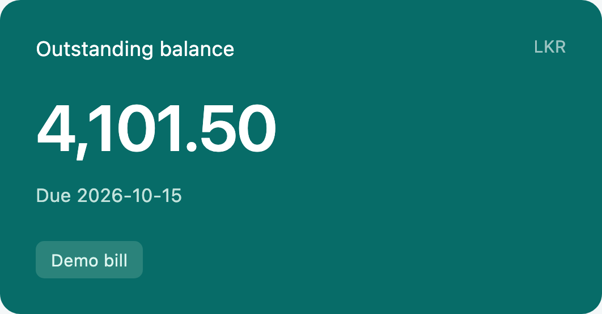

Figure 12 Balance after the demonstration payment

### 2.7 Meter readings and partner access

Figures 13 and 14 show meter entry and the stored readings. A new reading must not be lower than the previous one. Its time must be later than the last reading and not in the future. The database stores readings to three decimal places.

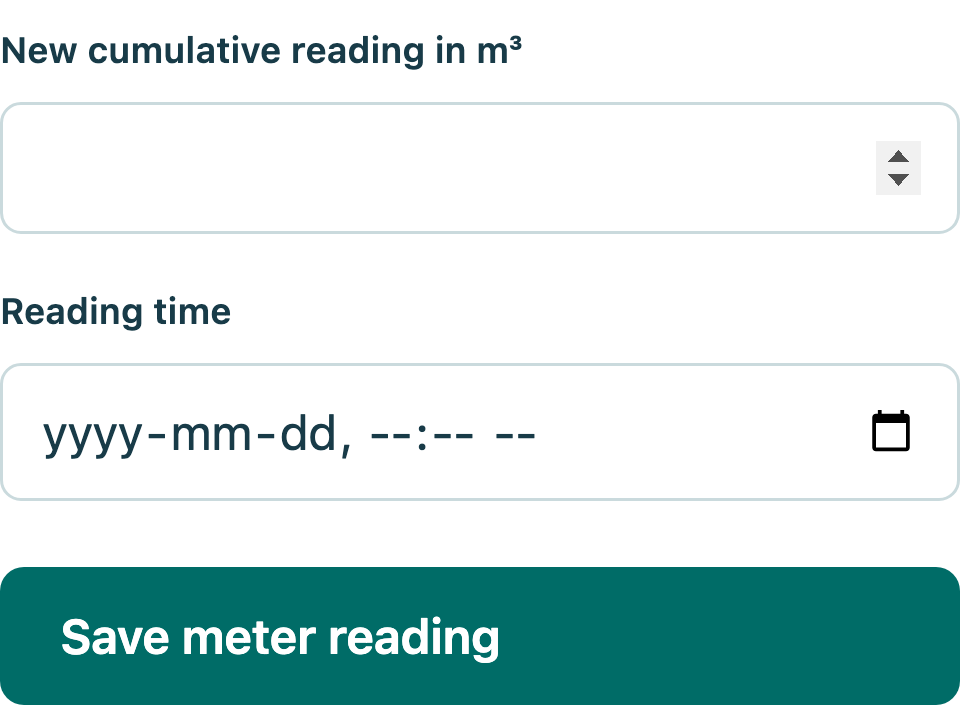

Figure 13 Operator meter reading form

Usage means the difference between the latest two recorded values. The screen shows their dates; it does not claim to provide live smart-meter data. The portal refreshes after a successful action or when the user selects Refresh. A service error is shown instead of presenting an old balance as current.

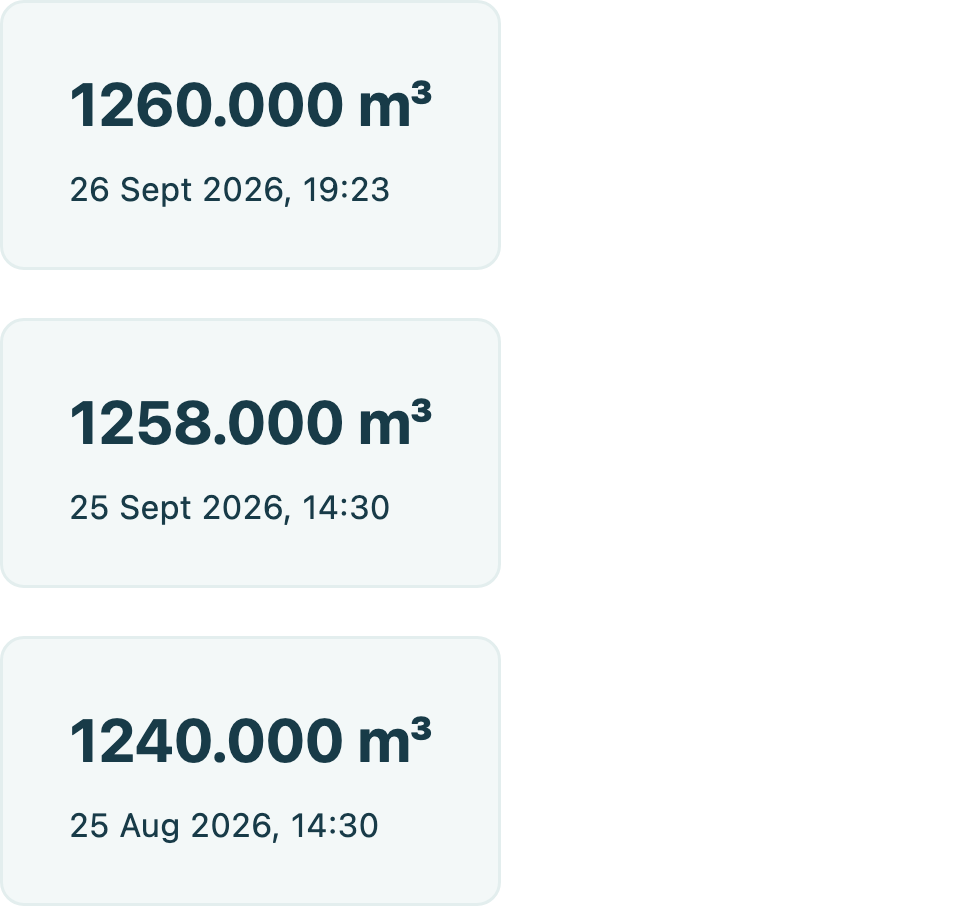

Figure 14 Saved meter readings with dates

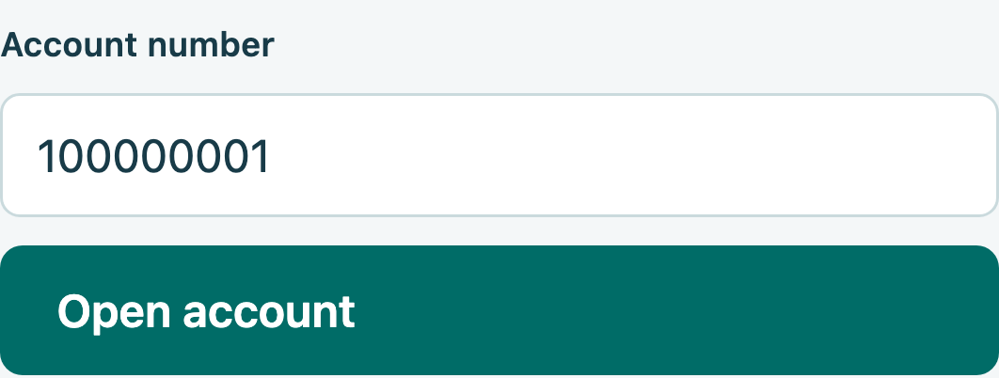

Figure 15 Partner account lookup

Figure 15 shows partner account lookup. The source package contains the complete web client, desktop client, services, API guide, OpenAPI file, diagrams and tests. README.md explains how to build and run them. The fixed demo identities must be replaced with real account and partner management before public use.

## 3 Testing and debugging

### 3.1 Test results

All 56 checks passed: 16 unit, 26 HTTP integration, 10 browser and four desktop HTTP checks. Table 2 lists selected cases from the saved results; each result matched its expected outcome. Use separate seeded data and the supplied demo tokens. TC04 and TC05 follow TC03. Complete scripts and logs are included in the source package. Native desktop interaction remains unverified. Cases TC01 to TC08 use HTTP integration tests; TC09 uses Chromium, and TC10 checks the desktop client HTTP calls without opening a native window.

Table 2 Recorded test cases

| Test ID | Test scenario | Prerequisites | Test steps | Result and status |
| --- | --- | --- | --- | --- |
| TC01 | Missing identity | Payment API running | Request balance without a token. | Pass: 401 |
| TC02 | Account access | Customer token | Request account 100000002 balance. | Pass: 403 |
| TC03 | New payment | Own account; balance above 100 | Send LKR 100 with a new reference. | Pass: 201; receipt |
| TC04 | Safe retry | TC03 completed | Repeat TC03; read balance. | Pass: same receipt; balance reduced once |
| TC05 | Changed retry | TC03 reference | Resend with amount 101. | Pass: 409 |
| TC06 | Invalid amount | Customer token | Submit 0, then 1.001 with separate references. | Pass: 400 for both |
| TC07 | Competing payments | Partner token; account 100000002 funded | Send two full-balance payments together with different references; read balance. | Pass: 201 and 409; balance zero |
| TC08 | Meter update | Operator token; last reading 1258 | Submit 1260 at current time; read usage. | Pass: 201; usage 2 m³ |
| TC09 | Browser payment | Customer signed in; balance above 25 | Enter 25 and a new reference; submit. | Pass: receipt shows 25.00 |
| TC10 | Desktop API client | Partner token; funded account | Run desktop smoke mode: lookup, pay, retry, refresh. | Pass: all four checks |

### 3.2 Faults found and fixed

The first package restore reported a high-severity issue in a SQLite dependency. The build treated it as an error. Updating Microsoft.Data.Sqlite to 10.0.12 fixed the restore without turning off the check. Another build failed because the desktop code used the old Watermark property. The saved error log pointed to the lines, and changing them to PlaceholderText fixed the build.

Figure 16 shows the saved successful build output. Review also added login rate limiting and a writable data folder for the non-root container user. Native desktop mouse and keyboard behaviour, Windows-specific use, Docker, Kubernetes and real bank settlement remain unverified. The report does not treat these as passed tests.

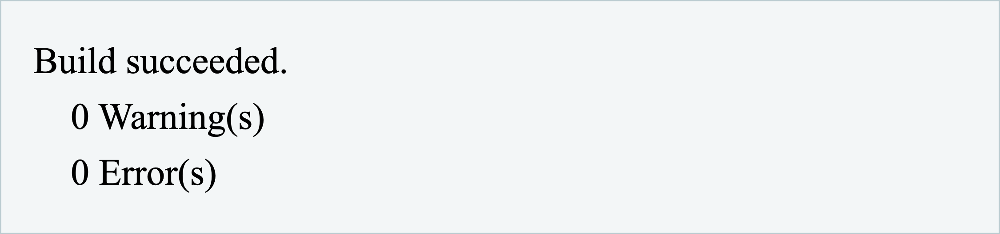

Figure 16 Saved build output after fixes

## 4 Deployment options

### 4.1 Server Docker and Kubernetes

A server can run the published .NET services behind an HTTPS reverse proxy. A service manager can start them again after a failure. This option needs few tools, but the team must manage certificates, updates, logs and backups. One server is still a shared point of failure.

Docker puts each host and its runtime in an image. The supplied Dockerfile uses a build stage and runs the final process as a non-root user. Compose connects the three hosts and gives the two APIs separate data volumes. Docker (n.d.) explains how production settings can differ from development settings. The supplied file is for a local demonstration and has not been run here.

Kubernetes can manage replicas, service discovery and rolling updates. It also needs more skills, monitoring and maintenance. Its production guide stresses planning for scale and availability (Kubernetes, n.d.). WaterLink would first need a server database for each service. A replica must not keep its own separate copy of the payment ledger.

Table 3 Deployment choice for this application

| Option | Best fit | Main limit |
| --- | --- | --- |
| Server | Simple controlled deployment | One machine may fail |
| Docker Compose | Small pilot with clear setup | Needs tested storage and security |
| Kubernetes | Larger managed service estate | More skills and database changes |

### 4.2 Recommended approach

The verified local process setup is the best choice for this assessment. A small pilot could use Docker Compose on a managed server after testing HTTPS, secrets and backups. Kubernetes is a later option if traffic and uptime needs justify it. No cost or capacity figure is claimed because the case gives no usage measurements or hosting budget.

Before each release, restore checked packages, build the code, run tests on separate data and try the release in a test environment. Database changes need a migration and rollback plan. Use a safe SQLite backup method or stop the writer before copying data. Test a restore as well as a backup. Real use also needs stronger identity management, per-partner access, settlement checks and monitoring.

## 5 Conclusion

WaterLink meets the core service design need by letting web and desktop clients use the same .NET payment service. Separate usage and payment services give each change a clear place. The tests show that the local payment and access rules work in the checked cases. Real public use would need stronger identity management, bank links and a tested deployment setup.

## Bibliography

Docker (n.d.) Use Compose in production. Available at: https://docs.docker.com/compose/how-tos/production/ (Accessed: 26 September 2026).

IBM (n.d.) What is service-oriented architecture. Available at: https://www.ibm.com/think/topics/soa (Accessed: 26 September 2026).

Kubernetes (n.d.) Production environment. Available at: https://kubernetes.io/docs/setup/production-environment/ (Accessed: 26 September 2026).

Microsoft (n.d.a) Microservices architecture style. Available at: https://learn.microsoft.com/en-us/azure/architecture/guide/architecture-styles/microservices (Accessed: 26 September 2026).

Microsoft (n.d.b) Best practices for RESTful web API design. Available at: https://learn.microsoft.com/en-us/azure/architecture/best-practices/api-design (Accessed: 26 September 2026).

Microsoft (n.d.c) Transactions. Available at: https://learn.microsoft.com/en-us/dotnet/standard/data/sqlite/transactions (Accessed: 26 September 2026).

Microsoft (n.d.d) API design. Available at: https://learn.microsoft.com/en-us/azure/architecture/microservices/design/api-design (Accessed: 26 September 2026).
